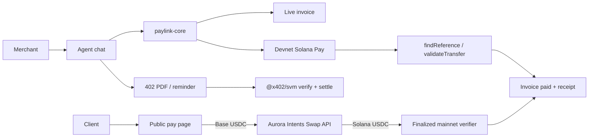

# PayLink

**Invoice in a sentence. Get paid in USDC on Solana — even when the client pays from Base.**

PayLink is an invoicing agent for freelancers and small studios. You type a plain sentence; the server-side model drafts the invoice fields; you review before anything is issued. Issued invoices settle as **USDC on Solana**. Clients who hold funds on Base (or other allowlisted chains) pay through **Aurora Intents**. Premium agent actions — a branded PDF and a smart reminder — are sold per call over **x402**.

- **Hackathon:** Encode Club Solana Hackathon 2026
- **Tracks:** Best Consumer App · Best Use of x402 · Aurora Intents bounty
- **Live demo:** https://paylink.181labs.build  
  - Public: landing, pay pages (`/pay/<id>`), receipts (`/receipts/<id>`), `/api/x402/*`  
  - Merchant side (dashboard, chat, wallet): access code **EARTH** (case-insensitive)
- **License:** [MIT](LICENSE)

---

## What it does

1. **AI invoice creation** — Free-form text goes to a server-only OpenAI-compatible chat completion with structured JSON. The merchant confirms amount and description before a draft is saved. Issuing is a separate step; confirming a draft does not email anyone or open a pay link by itself.
2. **Dashboard** — Invoice list plus monetary totals and collections chart for **Solana mainnet only**. Devnet and fixtures stay out of those totals.
3. **Pay from any chain (Aurora)** — For live invoices, the merchant receives Solana mainnet USDC. The payer can send Base USDC (and other allowlisted sources). PayLink marks paid only after an **independently verified, finalized Solana credit**.
4. **Receipts** — Public receipt page and free PDF (`?download=1` for attachment). Source deposit (reported) and merchant credit (verified) are shown separately.
5. **x402 premium actions** — Branded PDF (0.25 USDC) and reminder (0.05 USDC) on Solana **devnet**, with a spend cap (default 5 USDC).
6. **Email** — Optional Resend for paid notifications and unpaid reminders (only after verified payment / successful x402 settle + confirmation).
7. **Payment resume** — Live pay pages refresh on focus, visibility, and online events without creating duplicate deposit addresses.

### Mainnet proof (real funds)

| Item | Value |
| --- | --- |
| Invoice | PL-2026-1047 |
| Receipt | https://paylink.181labs.build/receipts/rcp_c9715460 |
| Flow | Base USDC → Aurora Intents → Solana mainnet USDC |
| Reported source deposit | 2.030498 Base USDC |
| Verified merchant credit | 2 USDC on Solana mainnet |

---

## How Solana powers this

Solana is the settlement rail, not a connect-wallet button.

### Devnet invoices (Solana Pay)

- Each issued demo invoice gets a unique **reference** public key and a `solana:` transfer-request URL for Circle **devnet USDC** (`4zMMC9srt5Ri5X14GAgXhaHii3GnPAEERYPJgZJDncDU`).
- The pay page shows a QR and can build the same transfer for Phantom / Solflare.
- Confirmation uses `findReference` + `validateTransfer`, plus token-balance deltas so short payments and wrong mints are reported separately.
- Explorer links use `cluster=devnet`.

### Live invoices (Solana mainnet USDC)

- Destination mint: mainnet USDC `EPjFWdd5AufqSSqeM2qN1xzybapC8G4wEGGkZwyTDt1v`.
- Aurora routes the cross-chain swap; PayLink does **not** treat provider success alone as paid.
- An independent verifier reads destination signatures at **finalized** commitment on a dedicated mainnet RPC and sums USDC balance deltas for the merchant. Only then does the invoice become paid and a receipt appear.
- Live invoices never mount the devnet wallet / Solana Pay path.

### x402 on Solana

- Network CAIP-2: `solana:EtWTRABZaYq6iMfeYKouRu166VU2xqa1` (devnet).
- Packages: `@x402/core` and `@x402/svm` 2.29.0, scheme **exact**.
- Headers: `PAYMENT-REQUIRED` / `PAYMENT-SIGNATURE` / `PAYMENT-RESPONSE` (V2 — not V1 `X-PAYMENT`).
- Details and failure table: [docs/x402.md](docs/x402.md).

---

## Aurora Intents — pay from any chain

Release 1 receives **Solana mainnet USDC** only. Sources are allowlisted Aurora asset IDs (Base USDC/ETH, Arbitrum USDC/ETH, Ethereum USDC/USDT/ETH) — never by symbol alone.

Integration: **Aurora Swap API**, `EXACT_OUTPUT`, one expiring origin-chain **deposit address** per payment attempt. The payer transfers from their own wallet; PayLink never signs, approves, or auto-debits the payer.

Lifecycle (stored attempt):

`quoted → awaiting_deposit → deposit_seen → processing → settlement_verifying → settled`

Incomplete / review / refund states branch separately. Client transaction hints are not payment proof.

Server-only configuration (names only; see Environment):

- `AURORA_INTENTS_API_KEY`
- `SOLANA_MAINNET_RPC_URL`

Failure and recovery behaviour (wrong chain/token, underpayment, RPC 429, provider FAILED vs SUCCESS-without-credit, resume ownership, etc.) is covered in the Aurora section of the app source and in tests under `apps/paylink-solana/lib/aurora*`.

---

## x402 premium actions

| Resource | Route | Default price |
| --- | --- | --- |
| Branded PDF | `GET`/`POST /api/x402/pdf?invoice=<id>` | 0.25 USDC |
| Smart reminder | `GET`/`POST /api/x402/reminder?invoice=<id>` | 0.05 USDC |

Without `PAYMENT-SIGNATURE`, the route returns **HTTP 402** with `x402Version: 2`, scheme `exact`, and pretty-printed JSON. Agent wallet policy defaults: total cap **5** USDC, per-call **0.5**, approve-above **0.1**. PDF waits for merchant approval; reminder auto-pays under the threshold when budget allows.

Idempotency: the same quote/proof cannot deliver twice; a settled-but-undelivered proof retries delivery without a second settle. Fail closed on facilitator/RPC errors.

Challenge example (unsigned, not a paid settle):

```http
GET https://paylink.181labs.build/api/x402/pdf?invoice=inv_2f85e2e8
```

---

## Architecture

```
apps/paylink-solana     Next.js 15 app — UI, Solana Pay, Aurora adapter, x402 resources, access gate
packages/paylink-core   Invoice state machine, budget, x402 policy, mailer (no Solana imports)
docs/x402.md            Protocol + failure table
deploy/                 Coolify/Traefik compose for the live host
```



---

## Run locally

Requirements: **Node 22+**, **pnpm 10**.

From the repository root:

```bash
pnpm install
cp .env.example .env.local
# Optional live Aurora vars are listed at the bottom of .env.example
pnpm dev
```

Open http://localhost:3000. Demo mode works without an LLM key (direct invoice commands). Free-form AI needs `LLM_API_KEY`.

```bash
pnpm devnet                 # keypairs + faucet instructions
pnpm pay -- --invoice inv_… # pay a devnet invoice from the payer key
pnpm test                   # app + core
pnpm typecheck && pnpm lint
```

Tests: **245** app + **34** core (Vitest).

### Environment (names only — never commit values)

Root `.env.example`:

| Variable | Purpose |
| --- | --- |
| `SOLANA_RPC_URL` | Server RPC (devnet) |
| `HELIUS_API_KEY` | Optional; used if `SOLANA_RPC_URL` empty |
| `NEXT_PUBLIC_SOLANA_RPC_URL` | Legacy; payer uses same-origin `/api/rpc` |
| `USDC_MINT` | Circle devnet USDC by default |
| `MERCHANT_SECRET_KEY`, `AGENT_SECRET_KEY`, `PAYER_SECRET_KEY` | Optional; else generated under `data/keys/` |
| `MERCHANT_NAME`, `MERCHANT_CITY`, `MERCHANT_EMAIL` | Profile defaults |
| `APP_URL` | Origin for links |
| `PAYLINK_DEMO_MODE` | Demo parser when no model key |
| `LLM_API_KEY`, `LLM_BASE_URL`, `LLM_MODEL` | Server-only interpreter |
| `RESEND_API_KEY`, `RESEND_FROM` | Optional email |
| `X402_PDF_PRICE_USDC`, `X402_REMINDER_PRICE_USDC`, `X402_QUOTE_TTL_SECONDS` | x402 prices / TTL |
| `BUDGET_TOTAL_USDC`, `BUDGET_PER_CALL_USDC`, `BUDGET_APPROVE_ABOVE_USDC` | Agent spend policy |
| `X402_FACILITATOR_URL` | Optional remote facilitator; empty = in-process `@x402/svm` |
| `DOMAIN` | Compose / Caddy hostname |
| `PAYLINK_ACCESS_CODE`, `PAYLINK_SESSION_SECRET` | Merchant gate |

App `.env.example` (live cross-chain):

| Variable | Purpose |
| --- | --- |
| `AURORA_INTENTS_API_KEY` | Aurora Swap API (server-only) |
| `SOLANA_MAINNET_RPC_URL` | Dedicated mainnet RPC for settlement verification (server-only) |

Never use `NEXT_PUBLIC_` for API keys, mainnet RPC secrets, or wallet secrets.

---

## Screens judges should open

| Path | What |
| --- | --- |
| `/` | Landing |
| `/chat` | Agent (behind access code) |
| `/dashboard` | Invoices + mainnet totals |
| `/pay/<id>` | Public pay page (devnet wallet or Aurora live panel) |
| `/receipts/rcp_c9715460` | Paid mainnet receipt |
| `/wallet` | Agent budget |
| `/activity` | x402 activity / failure lab |
| `/api/x402/pdf?invoice=inv_2f85e2e8` | Live 402 challenge |

---

## Built during the hackathon

Encode Club Solana Hackathon 2026 ran online from mid-October; final submissions close **Sunday 8 November 23:59 UTC-12** (**Monday 9 November 12:59 WAT**).

Nothing in this product was imported from an earlier codebase. PayLink (Solana Pay, x402, Aurora live path, UI, tests, deploy) was written during the hackathon window and extracted into this repository for submission.

---

## License

MIT © 2026 Khalil Salami.
